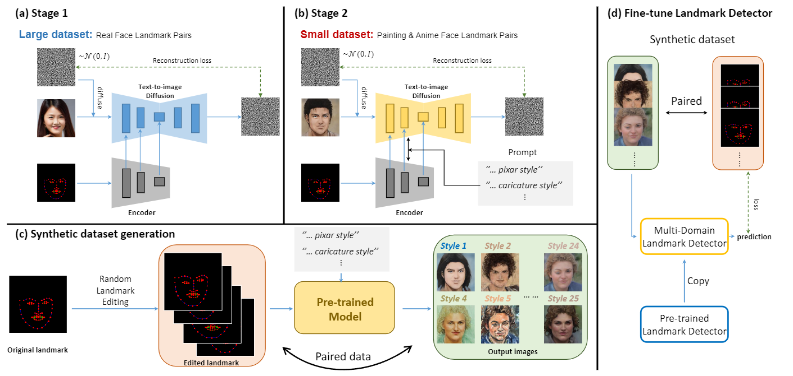

# Towards Multi-Domain Face Landmark Detection with Synthetic Data from Diffusion Model

This repository contains the synthetic dataset for our ICASSP 2024 paper titled "Towards Multi-Domain Face Landmark Detection with Synthetic Data from Diffusion Model". [](https://arxiv.org/abs/2401.13191)

## News

- **2026-11: cartoon model v2.** A fine-tuned checkpoint for cartoon and caricature faces. On the CariFace caricature test set it is more accurate than v1, especially for the eyes, mouth and nose. Download [`mdfld_cartoon_v2.pkl`](https://github.com/zenonLEE/MDFLD/releases/download/v2.0/mdfld_cartoon_v2.pkl) (65.8 MiB) from the [v2.0 release](https://github.com/zenonLEE/MDFLD/releases/tag/v2.0). For inference it is a drop-in replacement for the v1 model: pass it with `--pretrained_weight`. See [Cartoon model v2](#cartoon-model-v2).

## Introduction

Facial landmark detection is crucial for applications such as 3D facial reconstruction, face recognition, and augmented reality. While current methods work well for real-world images, detecting landmarks in other domains like cartoons or caricatures remains a challenge due to the lack of annotated training data.

In this work, we propose a two-stage training approach that leverages synthetic data generated by a pre-trained diffusion model to detect facial landmarks across multiple domains. Our method generates high-quality paired image-landmark datasets for various styles and fine-tunes an existing landmark detection model to achieve state-of-the-art results in multi-domain facial landmark detection.



## Installation

1. Clone the repository:
```bash
git clone https://github.com/zenonLEE/MDFLD.git
cd MDFLD
```

2. Install dependencies:
```bash
pip install -r requirements.txt
```

3. Download a pretrained model:
- **Cartoon model v2 (2026-11, recommended)**: [`mdfld_cartoon_v2.pkl`](https://github.com/zenonLEE/MDFLD/releases/download/v2.0/mdfld_cartoon_v2.pkl), SHA-256 `f061f616133fe0d2497093037af2a8ff6968fb898016188282fd0f914ae9d65e`. Pass its path with `--pretrained_weight`. Research use only, see [Terms of use](#terms-of-use).
- **Cartoon model v1 (paper version)**: [Download here](https://drive.google.com/file/d/1OjZDqkt41HAqAE5mJ586KMj8BUEHC6zn/view?usp=drive_link) (`best_model.zip`). Unzip it and place `best_model.pkl` at `./pretrained_model/cartoon_dataset_400_v2/starv2_smoothl1/model/best_model.pkl`, the default `--pretrained_weight`.

## Inference Usage

### Basic Usage

```bash
python test.py [OPTIONS]
```

### Inference Modes

#### 1. Standard Testing (with annotations)
Test on dataset with ground truth annotations:
```bash
python test.py --mode=test \
               --device_ids=0 \
               --image_dir=/path/to/images \
               --annot_dir=/path/to/annotations \
               --data_definition=CariFace_testset \
               --pretrained_weight=/path/to/model.pkl
```
`--data_definition` selects the landmark layout and the annotation file `<annot_dir>/<data_definition>/test.tsv`. The cartoon models predict 68 points, so use any name except `WFLW` (98 points) and `COFW` (29 points), which build a different network that cannot load them.

#### 2. Image-Only Testing (without annotations)
Test on images without ground truth (inference only):
```bash
python test.py --mode=test_image \
               --device_ids=0 \
               --image_dir=/path/to/test/images \
               --pretrained_weight=/path/to/model.pkl
```

## Cartoon model v2

v2 is the v1 model fine-tuned with self-training on cartoon and caricature faces, plus a small set of real-face video frames (see [Training](#training)). The architecture and checkpoint format are unchanged: STAR's `StackedHGNetV1` (4 stacks, 68 landmarks, 256×256 input, `classes_num=[68, 9, 68]`, `add_coord=True`, `use_AAM=True`), with the weights in `checkpoint["net"]` (EMA weights). `checkpoint["meta"]` records the input and output conventions. The file holds only `net` and `meta`, no training state, so `--mode=train` cannot resume from it.

### Results

CariFace test set: 1,560 caricatures with the 68-point ground truth released with CariFace (caricatures collected from the Internet were labelled by hand after dlib initialisation; those generated with CariGANs were labelled automatically). The test images were not used for training, but their labels were used to tune the pseudo-labelling settings (flip averaging, upper-lid correction and filter thresholds). NME is in % of the outer eye-corner distance (0-based points 36 and 45); lower is better.

| Crop | Model | All 68 | Eyes | Mouth | Nose | Eyebrows | Jaw | Eye failure rate |
|---|---|---|---|---|---|---|---|---|
| `demo.py` crop, 1 pass | v1 | 7.81 | 4.57 | 6.44 | 5.20 | 10.48 | 11.51 | 6.8% |
| | v2 | **6.43** | **3.80** | **4.88** | **3.95** | **9.95** | **9.36** | **5.1%** |
| Tight crop, 2 passes | v1 | 8.31 | 3.82 | 6.30 | 4.96 | **12.33** | 13.24 | 3.3% |
| | v2 | **7.63** | **3.17** | **4.73** | **3.87** | 13.63 | **12.67** | **1.7%** |

- Bold marks the better of v1 and v2 for each crop.
- Regions use 0-based points: jaw 0–16, eyebrows 17–26, nose 27–35, eyes 36–47, mouth 48–67. Eye failure rate is the share of images whose eye NME is above 10%.
- Both crops are squares. The first pass is centred on the bounding box (w × h) of the ground-truth 68 points. The `demo.py` crop has side 1.05 × min(w, h), as in `demo.py` (`scale = min(w, h) / 200 * 1.05`, where `demo.py` takes the box from dlib's 68 points). The tight crop has side 0.9 × max(w, h); its second pass applies the same rule to the box of the first-pass landmarks.
- Neither crop always holds the whole face. The tight crop cuts off eyebrow tops and jaw points, and the `demo.py` crop, which follows the shorter side of the box, cuts off the top and bottom of long faces. Part of the error on those points comes from the crop, for both models.
- The tight crop gives the most accurate eyes; the `demo.py` crop gives better eyebrows and jaw.
- No flip test or post-processing is used. These numbers come from our own crops and are not directly comparable with the tables in the paper.

### Training

v2 starts from v1 and is trained for 6,000 iterations with batch size 48: Adam, learning rate 1e-4 with a 200-iteration linear warm-up and cosine decay to 1e-6, gradient clipping at norm 5, EMA 0.998. Training crops are squares around the 68-point box with side 0.78–1.12 × max(w, h), a centre shift of up to 6%, rotation N(0, 12°) clipped to ±30°, horizontal flips, and colour, blur and JPEG augmentation. The loss is plain smooth-L1 on the landmark coordinates (instead of the STAR loss) plus AWing on the landmark and edge heatmaps, weighted 1 : 10 : 10, with deeper stacks weighted more. CariFace eye points are weighted 1.5×; for pseudo-labelled faces the jaw points are left out and the other non-eye points are weighted 0.5×.

| Data | Style | Faces | Labels | Share of samples |
|---|---|---|---|---|
| [CariFace](https://github.com/Juyong/CaricatureFace): the 7,800 images minus the 1,560 test images, and 300 more held out for validation | caricatures | 5,940 | CariFace ground truth | 45.8% |
| [iCartoonFace](https://github.com/luxiangju-PersonAI/iCartoonFace) | 2D animation | 4,766 | pseudo | 10.4% |
| [anime-faces-256](https://huggingface.co/datasets/puruchinera/anime-faces-256) | anime | 7,673 | pseudo | 16.7% |
| [Cartoon Set](https://google.github.io/cartoonset/) by Google LLC ([CC BY 4.0](https://creativecommons.org/licenses/by/4.0/)), via an [HF copy](https://huggingface.co/datasets/Skiittoo/cartoon-faces) | flat cartoon avatars | 4,586 | pseudo | 10.4% |
| [pixar-images](https://huggingface.co/datasets/lavaman131/pixar-images) | 3D animation | 107 | pseudo | 4.2% |
| In-house video frames | real faces | 416 | automatic | 12.5% |

Pseudo-labels come from two rounds of self-training. v1 labelled the unlabelled sets to train a round-1 model; the round-1 model relabelled them, and v2 was trained from v1 on those labels. Each label is the average of the prediction and its horizontal flip (with an image-based upper-lid correction where the lid was clearly underestimated), and a face is kept only if the two predictions agree and the eye shapes are plausible.

If you use v2, please also cite the datasets it was trained on: CariFace (Cai, Guo, Peng and Zhang, "Landmark detection and 3D face reconstruction for caricature using a nonlinear parametric model", Graphical Models 115:101103, 2021) and iCartoonFace (Zheng et al., "Cartoon Face Recognition: A Benchmark Dataset", ACM Multimedia 2020, pp. 2264–2272).

### Limitations

- Results are measured on caricatures only; there are no benchmark numbers for 2D animation, anime or 3D cartoon faces.
- Each eye has only 6 points in the 68-point layout (2 corners and 2 points on each lid), so very round or oversized cartoon eyes are fitted with an almond shape; lower lids and eye corners can cut into the eye.
- On 3D cartoon characters with a thick dark lash line next to a dark iris, the upper-lid points can sit a few pixels too high.
- With the tight crop, the eyebrows are less accurate than with v1 (see the table).

### Terms of use

The v2 weights are for research use only and come without warranty. They were trained on third-party data: CariFace is released for research purposes only, and iCartoonFace, anime-faces-256 and pixar-images contain third-party cartoon artwork and film frames (the two Hugging Face sets state no license). Please follow each dataset's terms.

## Dataset
We created a large multi-domain facial landmark dataset with 25 different styles, each containing 400 images and annotations. The dataset is publicly available in this repository.
The multi-domain facial landmark dataset is available for download:
- [Download Dataset from Google Drive] [google drive link](https://drive.google.com/file/d/1taZfY8_IETJG2DkhXxv7U3JpPEokkBb4/view?usp=sharing)
### Dataset Structure:
- **Styles**: The dataset includes 25 distinct styles, each representing different visual domains.
- **Image Resolution**: The images are resized to 256x256 for consistent processing.
- **Annotations Format**: The 68 landmarks are provided as 2D coordinates (x, y) for each image, indicating the positions of important facial features..

### Example Styles:
- Caricatures
- Pixar-style characters
- Hand-drawn illustrations
- Artistic portraits
- ... ...


### Citation
If you use this dataset or find our work useful, please consider citing our paper:

```plaintext
@inproceedings{li2024towards,
  title={Towards Multi-Domain Face Landmark Detection with Synthetic Data from Diffusion Model},
  author={Li, Yuanming and Kim, Gwantae and Kwak, Jeong-gi and Ku, Bon-hwa and Ko, Hanseok},
  booktitle={ICASSP 2024-2024 IEEE International Conference on Acoustics, Speech and Signal Processing (ICASSP)},
  pages={6730--6734},
  year={2024},
  organization={IEEE}
}
```
