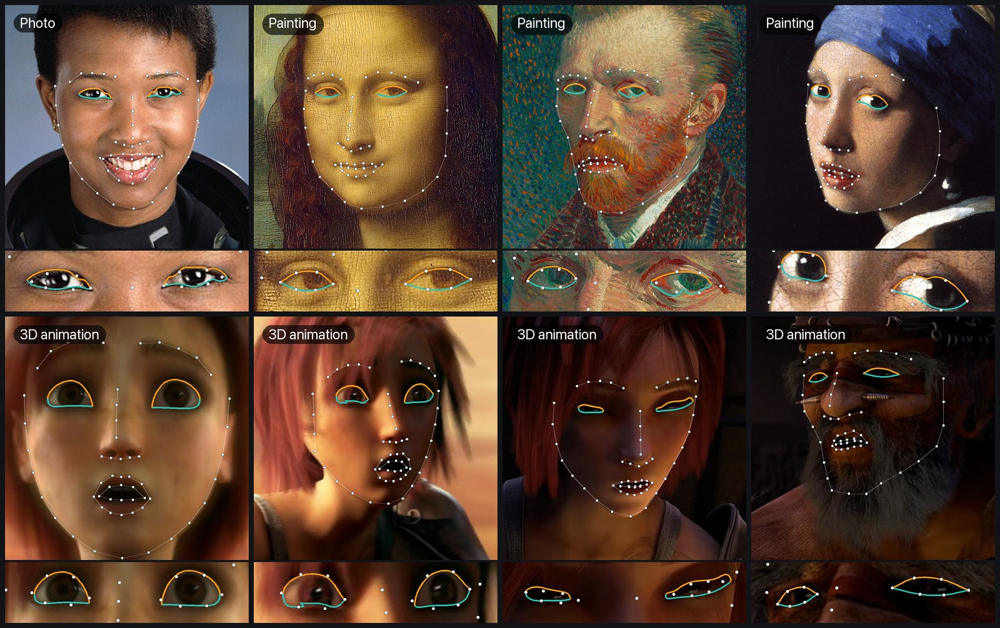
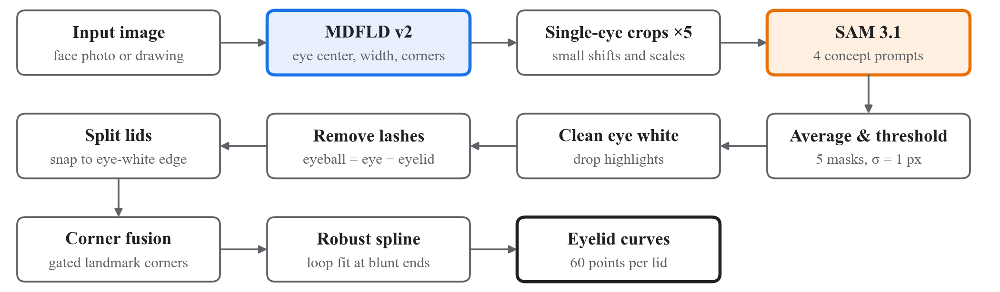

<div align="center">

# Towards Multi-Domain Face Landmark Detection with Synthetic Data from Diffusion Model

**MDFLD** · ICASSP 2024

Yuanming Li · Gwantae Kim · Jeong-gi Kwak · Bon-hwa Ku · Hanseok Ko<br>
Korea University

[](https://arxiv.org/abs/2401.13191)
[](https://arxiv.org/abs/2401.13191)
[](#quick-start)
[](https://github.com/zenonLEE/MDFLD/releases)
[](https://github.com/zenonLEE/MDFLD)

**[Quick start](#quick-start)** · **[Results](#results)** · **[Eyelid curves](#eyelid-contours-v21)** · **[Dataset](#synthetic-dataset-icassp-2024)** · **[Citation](#citation)**



<sub>Output of <code>mdfld image</code> with default settings; under each face, a zoom of the eyes. None of these images was used for training. <a href="#acknowledgements">Image credits</a>.</sub>

</div>

## News

- **2026-11 · pip package.** An `mdfld` command and Python API for images and videos. See [Quick start](#quick-start).
- **2026-11 · Eyelid contours (v2.1).** Smooth eyelid curves without the lash band. See [Eyelid contours](#eyelid-contours-v21).
- **2026-11 · Cartoon model v2.** More accurate than the paper model, especially for the eyes, mouth and nose. See [Cartoon model v2](#cartoon-model-v2).
- **2024 · ICASSP 2024.** Paper and synthetic dataset released. See [Synthetic dataset](#synthetic-dataset-icassp-2024).

## Quick start

Python 3.10–3.12 with a CUDA GPU. Install PyTorch 2.4 or newer for your CUDA version first, then:

```bash
pip install "mdfld[sam] @ git+https://github.com/zenonLEE/MDFLD"

mdfld image face.png --out face.json --vis face_mdfld.png
mdfld video clip.mp4 --out clip.json --vis clip_mdfld.mp4
```

```python
from mdfld import MDFLD

r = MDFLD().image("face.png")   # face box, 68 landmarks, eyelid curves
```

SAM 3.1 weights are gated: request access at [facebook/sam3.1](https://huggingface.co/facebook/sam3.1) and log in with `hf auth login` (or set `HF_TOKEN`). See [Install](#install) for other options.

## Python package

The `mdfld` package runs the whole pipeline: it finds the face with SAM 3.1, predicts 68 landmarks with the v2 model, and extracts lash-free eyelid curves (see [Eyelid contours](#eyelid-contours-v21)). The v2 model is a TorchScript file that is downloaded on first use, so no network code is needed.

### Install

Use a separate environment, and install PyTorch (2.4 or newer) and torchvision for your CUDA version first, so that pip does not replace them. Then `pip install "mdfld[sam] @ git+https://github.com/zenonLEE/MDFLD"`.

- SAM 3.1: log in to Hugging Face after requesting access, or pass a local `sam3.1_multiplex.pt` with `--sam-checkpoint` (or the `MDFLD_SAM3_CKPT` environment variable).
- The landmark model is cached in `~/.cache/mdfld` (or `$MDFLD_HOME`).
- Without the `[sam]` extra, or without a GPU, the package still predicts landmarks when you give it a face box and turn eyelids off: `mdfld image face.png --box 120,80,620,640 --no-eyelids --out face.json`.

### Use

```python
from mdfld import MDFLD

m = MDFLD()                       # mode: "default", "fast" or "best"
r = m.image("face.png")           # {"face_box", "landmarks": 68 x [x, y], "eyelids": {"L", "R"}}
v = m.video("clip.mp4", vis="clip_mdfld.mp4")
for f in v["frames"]:             # one entry per frame: "face_box", "landmarks", "eyelids"
    ...
```

| Mode | Eyelid step | Time per image, one GPU | Difference from `best` (cartoon eyes) |
|---|---|---|---|
| `best` | the v2.1 setup (SAM 3.1 video predictor, 5 crops per eye) | ~5.0 s | – |
| `default` | SAM image API, 5 crops per eye | ~2.5 s | median 0.9 px, max 4.1 px |
| `fast` | SAM image API, 3 crops per eye | ~1.9 s | median 1.1 px, max 4.3 px |

<details>
<summary>Output format and timing details</summary>

- One face per image or frame: the highest-scoring face (in videos, the one that overlaps the previous frame's face).
- `landmarks` are 68 points in the iBUG 300-W order (0-based), in pixels of the upright image (image files are turned according to their EXIF orientation). Arrays passed to the Python API are taken as RGB, so convert frames read with OpenCV first (`frame[..., ::-1]`).
- Landmarks come from three passes of the v2 model: the first on the face box, the next two on a square of 1.1 × the larger side of the previous points' box, which keeps the jaw and eyebrows inside the crop (see [Results](#results)).
- `eyelids` has the image-left (`L`) and image-right (`R`) eye, each with `upper` and `lower` curves of 60 points and a `source`. `sam` means the curve comes from SAM 3.1; `landmarks` means SAM found no eye, or its curve failed a sanity check against the eye landmarks (wrong width, position or height, as when SAM outlines only the iris), and the curves pass through the 6 eye landmarks instead. See [Eyelid contours](#eyelid-contours-v21) for the other fields.
- The command line writes `{input path: result}` for images (also for a single image) and the video result as is. `--no-eyelids` gives landmarks only.
- Times are averages over 17 images of 1404 × 1404 on an NVIDIA RTX PRO 6000, including finding the face, the landmarks and loading SAM for the first image. Differences are Hausdorff distances between eyelid curves on the 28 cartoon eyes of the [eyelid test set](#results-1); for the 6 realistic eyes, `default` differs by a median of about 0.6 px. `best` keeps a second copy of SAM 3.1 in GPU memory.

</details>

### Video

Every frame is processed like an image, then each shot is smoothed over time with a [One Euro filter](https://gery.casiez.net/1euro/) run forwards and backwards, so the smoothing adds no lag. On a 10-second test clip this removed about a quarter of the frame-to-frame motion of the eyelid curves while keeping about 93% of the depth of blinks.

- `--min-cutoff` (default 1.0 Hz; lower is smoother) and `--beta` (default 5; higher keeps fast motion such as blinks) tune the filter; `--no-smooth` turns it off.
- `--every N` runs SAM for the eyelids only every N frames (and on the first and last frame of each shot) and interpolates in between, following the eye corners. It is faster but can miss blinks shorter than N frames.
- Eyes without a usable SAM curve get the landmark curves, as for images. Each eye's `source` says `sam`, `interpolated` (between key frames, with `--every`) or `landmarks`.
- Speed with `--mode fast` on one NVIDIA RTX PRO 6000 (1404 × 1404 frames): about 1.2 s per frame, or 0.5 s per frame with `--every 3`.

### Notes

- The v2 model is for research use only; see the [terms of use](#terms-of-use).
- SAM 3.1 is not part of this repository; its code and weights are under Meta's SAM License, which asks that publications using it acknowledge SAM.

## Cartoon model v2

v2 is the v1 model fine-tuned with self-training on cartoon and caricature faces, plus a small set of real-face video frames (see [Training](#training)). Download: [v2.0 release](https://github.com/zenonLEE/MDFLD/releases/tag/v2.0) (`mdfld_cartoon_v2.torchscript.pt` for the package, `mdfld_cartoon_v2.pkl` for the [original code](#paper-model-v1-and-the-original-code)).

### Results

CariFace test set: 1,560 caricatures. NME in % of the outer eye-corner distance (lower is better); eye failure = eye NME above 10%. Both models use the package setting (see below).

| Model | All 68 | Eyes | Mouth | Nose | Eyebrows | Jaw | Eye failures |
|---|---|---|---|---|---|---|---|
| v1 (paper) | 6.70 | 3.49 | 6.29 | 4.81 | 6.77 | 10.42 | 2.6% |
| **v2** | **5.03** | **2.78** | **4.62** | **3.80** | **5.01** | **7.75** | **0.9%** |

On 313 held-out real-face video frames with automatic labels, v2 reaches an NME of 1.74% (v1: 3.03%).

<details>
<summary>Other crops, protocol and notes</summary>

| Crop | Model | All 68 | Eyes | Mouth | Nose | Eyebrows | Jaw | Eye failures |
|---|---|---|---|---|---|---|---|---|
| `demo.py` crop, 1 pass | v1 | 7.81 | 4.57 | 6.44 | 5.20 | 10.48 | 11.51 | 6.8% |
| | v2 | **6.43** | **3.80** | **4.88** | **3.95** | **9.95** | **9.36** | **5.1%** |
| Tight crop, 2 passes | v1 | 8.31 | 3.82 | 6.30 | 4.96 | **12.33** | 13.24 | 3.3% |
| | v2 | **7.63** | **3.17** | **4.73** | **3.87** | 13.63 | **12.67** | **1.7%** |
| Package setting, 3 passes | v1 | 6.70 | 3.49 | 6.29 | 4.81 | 6.77 | 10.42 | 2.6% |
| | v2 | **5.03** | **2.78** | **4.62** | **3.80** | **5.01** | **7.75** | **0.9%** |

- Bold marks the better of v1 and v2 for each crop.
- The CariFace ground truth was released with CariFace: caricatures collected from the Internet were labelled by hand after dlib initialisation, those generated with CariGANs automatically. The test images were not used for training, but their labels were used to tune the pseudo-labelling settings (flip averaging, upper-lid correction and filter thresholds).
- Regions use 0-based points: jaw 0–16, eyebrows 17–26, nose 27–35, eyes 36–47, mouth 48–67; the eye-corner distance is between points 36 and 45.
- All crops are squares. The first pass is centred on the bounding box (w × h) of the ground-truth 68 points. The `demo.py` crop has side 1.05 × min(w, h), as in `demo.py` (`scale = min(w, h) / 200 * 1.05`, where `demo.py` takes the box from dlib's 68 points). The tight crop has side 0.9 × max(w, h); its second pass applies the same rule to the box of the first-pass landmarks. The package setting, used by the [`mdfld` package](#python-package), has side 1.0 × max(w, h) in the first pass and 1.1 × max(w, h) of the previous points' box in the second and third.
- The tight crop cuts off eyebrow tops and jaw points, and the `demo.py` crop, which follows the shorter side of the box, cuts off the top and bottom of long faces. Points outside the crop end up too far inside: with the tight crop, v2's jaw points lie on average 7.4% of the eye-corner distance inside the true jaw line. The package setting keeps the whole face in the crop and is the most accurate for every region, for both models.
- No flip test or post-processing is used. These numbers come from our own crops and are not directly comparable with the tables in the paper.

</details>

### Training

<details>
<summary>Training recipe and data</summary>

v2 starts from v1 and is trained for 6,000 iterations with batch size 48: Adam, learning rate 1e-4 with a 200-iteration linear warm-up and cosine decay to 1e-6, gradient clipping at norm 5, EMA 0.998. Training crops are squares around the 68-point box with side 0.78–1.12 × max(w, h), a centre shift of up to 6%, rotation N(0, 12°) clipped to ±30°, horizontal flips, and colour, blur and JPEG augmentation. The loss is plain smooth-L1 on the landmark coordinates (instead of the STAR loss) plus AWing on the landmark and edge heatmaps, weighted 1 : 10 : 10, with deeper stacks weighted more. CariFace eye points are weighted 1.5×; for pseudo-labelled faces the jaw points are left out and the other non-eye points are weighted 0.5×.

| Data | Style | Faces | Labels | Share of samples |
|---|---|---|---|---|
| [CariFace](https://github.com/Juyong/CaricatureFace): the 7,800 images minus the 1,560 test images, and 300 more held out for validation | caricatures | 5,940 | CariFace ground truth | 45.8% |
| [iCartoonFace](https://github.com/luxiangju-PersonAI/iCartoonFace) | 2D animation | 4,766 | pseudo | 10.4% |
| [anime-faces-256](https://huggingface.co/datasets/puruchinera/anime-faces-256) | anime | 7,673 | pseudo | 16.7% |
| [Cartoon Set](https://google.github.io/cartoonset/) by Google LLC ([CC BY 4.0](https://creativecommons.org/licenses/by/4.0/)), via an [HF copy](https://huggingface.co/datasets/Skiittoo/cartoon-faces) | flat cartoon avatars | 4,586 | pseudo | 10.4% |
| [pixar-images](https://huggingface.co/datasets/lavaman131/pixar-images) | 3D animation | 107 | pseudo | 4.2% |
| In-house video frames | real faces | 416 | automatic | 12.5% |

Pseudo-labels come from two rounds of self-training. v1 labelled the unlabelled sets to train a round-1 model; the round-1 model relabelled them, and v2 was trained from v1 on those labels. Each label is the average of the prediction and its horizontal flip (with an image-based upper-lid correction where the lid was clearly underestimated), and a face is kept only if the two predictions agree and the eye shapes are plausible.

The architecture and checkpoint format are unchanged from v1: STAR's `StackedHGNetV1` (4 stacks, 68 landmarks, 256×256 input, `classes_num=[68, 9, 68]`, `add_coord=True`, `use_AAM=True`). In `mdfld_cartoon_v2.pkl` the weights are in `checkpoint["net"]` (EMA weights) and `checkpoint["meta"]` records the input and output conventions; the file holds no training state, so `--mode=train` cannot resume from it.

If you use v2, please also cite the datasets it was trained on: CariFace (Cai, Guo, Peng and Zhang, "Landmark detection and 3D face reconstruction for caricature using a nonlinear parametric model", Graphical Models 115:101103, 2021) and iCartoonFace (Zheng et al., "Cartoon Face Recognition: A Benchmark Dataset", ACM Multimedia 2020, pp. 2264–2272).

</details>

### Limitations

- Results are measured on caricatures (and, with automatic labels, real faces) only; there are no benchmark numbers for 2D animation, anime or 3D cartoon faces.
- Each eye has only 6 points in the 68-point layout (2 corners and 2 points on each lid), so very round or oversized cartoon eyes are fitted with an almond shape; lower lids and eye corners can cut into the eye.
- On 3D cartoon characters with a thick dark lash line next to a dark iris, the upper-lid points can sit a few pixels too high.
- Profile views, heavy beards and sketchy line drawings are hard: on such faces the mouth and jaw points can be far off.
- With the tight crop, the eyebrows are less accurate than with v1; with the package setting they are more accurate (see the table).

### Terms of use

The v2 weights are for research use only and come without warranty. They were trained on third-party data: CariFace is released for research purposes only, and iCartoonFace, anime-faces-256 and pixar-images contain third-party cartoon artwork and film frames (the two Hugging Face sets state no license). Please follow each dataset's terms.

## Eyelid contours (v2.1)

The 68-point layout gives each eye only six points, so the lid curve between them is interpolated (see [Limitations](#limitations)). This step turns v2 landmarks into dense upper and lower eyelid curves without the lash band. It needs no training and does not change the v2 weights.

<p align="center"></p>

For each eye, the landmarks give the crop, the scale (eye width) and the corner positions. [SAM 3.1](https://github.com/facebookresearch/sam3) is asked for four text prompts ("eye", "eyelid", "white of the eye", "pupil") on five slightly shifted single-eye crops, and the masks are averaged. On cartoons "eyelid" returns the lash band or eyeliner, so the eyeball is the eye minus the eyelid, keeping eye-white pixels. The contour is split into the upper and lower lid, snapped to the edge of the eye white and fitted with a robust smoothing spline; round eye ends are fitted through, so the two lids meet smoothly. An eye corner is moved to the landmark corner only when SAM stops short of it, which is typical for realistic faces, where SAM covers just the visible eye white.

### Results

17 in-house stills at 1404 × 1404 (14 cartoon characters and 3 realistic faces, 34 eyes), none of them used to train v2. There is no pixel ground truth, so the table reports medians of two proxies: **lash band inside**, the share of SAM's "eyelid" mask that falls inside the contour (on the 25 cartoon eyes where SAM found an eyelid mask), and **roughness**, the RMS distance between the closed contour, resampled every 0.5 px, and a copy of it smoothed with a Gaussian of σ = 2.5 px. Lower is better for both.

| Contour | Lash band inside, cartoon | Roughness (px), cartoon | Roughness (px), realistic |
|---|---|---|---|
| SAM 3.1 "eye" on the face crop | 0.22 | 0.24 | 0.32 |
| v2 landmarks, interpolated | 0.09 | 0.17 | 0.28 |
| v2 + eyelid step | **0.02** | **0.10** | 0.29 |

<details>
<summary>More on these measures</summary>

- The lash-band share uses SAM's own mask, so it favours the method. A measure that does not depend on SAM also improves on cartoon eyes: the mean image gradient along the contour, divided by the 95th-percentile gradient around the eye, is 1.60 against 1.08 for the interpolated landmark curve.
- Part of the roughness of a mask outline is pixel steps: a perfect ellipse of eye size, drawn into pixels, already scores 0.20–0.27 px.
- On realistic faces the curves are close to the landmark curves (median of the per-eye mean distance 1.1 px, at most 1.4 px), and all 12 realistic eye corners end at the landmark corners. 55 of the 56 cartoon corners come from SAM's eyeball outline.

</details>

### Usage

The [pip package](#python-package) runs this step for you. To run it on your own landmarks:

<details>
<summary>Stand-alone script</summary>

1. Set up a separate environment with a CUDA GPU: this repository's `requirements.txt` pins old versions, while SAM 3 needs a recent PyTorch. Install SAM 3 as described in [facebookresearch/sam3](https://github.com/facebookresearch/sam3) (tested at commit `f1647e8`), then `pip install opencv-python scipy pillow`.
2. Download `sam3.1_multiplex.pt` from [facebook/sam3.1](https://huggingface.co/facebook/sam3.1). Access is gated: request it on that page and accept the SAM License.
3. Get 68 landmarks for each face (iBUG order, 0-based), for example with v2. They must be in pixels of the full image as it is stored (the tool reads images with PIL and does not apply EXIF rotation). Save them as a text file with 68 lines of `x y`, a `(68, 2)` `.npy` file or a JSON list.
4. Run:

```bash
python eyelid/eyelid_sam31.py --sam3-ckpt sam3.1_multiplex.pt \
    --image face.png --landmarks face_68.txt --out face_eyelids.json --vis face_eyelids.png
```

For many images, pass `--batch landmarks.json --image-root images/` instead of `--image` and `--landmarks`. The JSON maps each image path (relative to `--image-root`) to its 68 points; with `--batch`, `--vis` is a folder.

The output maps each image to `{"L": {...}, "R": {...}}` for the image-left and image-right eye. Each eye has:

- `upper` and `lower`: 60 points each, in image pixels, ordered from the image-left corner to the image-right corner;
- `landmark_corners`: which ends (`"L"` = image-left, `"R"` = image-right) were moved to the landmark corner;
- `blunt_ends`: which ends were fitted through as round ends.

An eye is `null` when SAM found no eye on the landmarks. In batch mode an image that fails is recorded as `{"error": "..."}` and the run continues. Unlike the pip package, the script does not check the curves against the landmarks.

</details>

### Notes

- Speed: SAM 3.1 runs 5 crops × 4 prompts per eye, about 4 s per image on one NVIDIA RTX PRO 6000 (69 s for the 17 stills, plus about 14 s to load the model). The other steps take about 40 ms per eye on the CPU.
- The thresholds were set on these 34 eyes, whose eye widths are 60–170 px. If a face's mean eye width is outside 60–180 px, the face is cropped and rescaled so that the eye width becomes 100 px (small eyes) or 120 px (large eyes), and the curves are mapped back. The script's `--no-rescale` turns this off. The rescaling has only had a quick check: on two images shrunk until the eyes were 33–48 px wide, the curves stayed within about 4 px (at the original resolution) of the full-resolution result, but corner decisions can change.
- On styles unlike these 34 eyes (oil paintings with dark eye whites, squinting eyes behind glasses, sketches), SAM may outline only the iris or the whole eye socket. The pip package then falls back to the landmark curves.
- Where SAM's "pupil" covers the whole iris (black irises, realistic eyes), removing highlights near the pupil also removes a thin ring of eye white, which can move the curve by up to about 3 px.
- If the landmarks put an eye in the wrong place, the wrong SAM instance is picked.

## Synthetic dataset (ICASSP 2024)

Facial landmark detection is crucial for applications such as 3D facial reconstruction, face recognition, and augmented reality. While current methods work well for real-world images, detecting landmarks in other domains like cartoons or caricatures remains a challenge due to the lack of annotated training data.

In this work, we propose a two-stage training approach that leverages synthetic data generated by a pre-trained diffusion model to detect facial landmarks across multiple domains. Our method generates high-quality paired image-landmark datasets for various styles and fine-tunes an existing landmark detection model to achieve state-of-the-art results in multi-domain facial landmark detection.

| Styles | Images per style | Resolution | Annotations |
|---|---|---|---|
| 25, e.g. caricatures, Pixar-style characters, hand-drawn illustrations, artistic portraits | 400 | 256 × 256 | 68 landmarks (x, y) per image |

**[Download the dataset from Google Drive](https://drive.google.com/file/d/1taZfY8_IETJG2DkhXxv7U3JpPEokkBb4/view?usp=sharing)**

## Paper model (v1) and the original code

The paper model (v1) and the [STAR](https://github.com/ZhenglinZhou/STAR)-based training and test code. The code also runs the v2 checkpoint (`mdfld_cartoon_v2.pkl`).

<details>
<summary>Installation, models and inference with the original code</summary>

1. Clone the repository:
```bash
git clone https://github.com/zenonLEE/MDFLD.git
cd MDFLD
```

2. Install dependencies:
```bash
pip install -r requirements.txt
```

3. Download a pretrained model:
- **Cartoon model v2 (2026-11, recommended)**: [`mdfld_cartoon_v2.pkl`](https://github.com/zenonLEE/MDFLD/releases/download/v2.0/mdfld_cartoon_v2.pkl), SHA-256 `f061f616133fe0d2497093037af2a8ff6968fb898016188282fd0f914ae9d65e`. Pass its path with `--pretrained_weight`. Research use only, see [Terms of use](#terms-of-use).
- **Cartoon model v1 (paper version)**: [Download here](https://drive.google.com/file/d/1OjZDqkt41HAqAE5mJ586KMj8BUEHC6zn/view?usp=drive_link) (`best_model.zip`). Unzip it and place `best_model.pkl` at `./pretrained_model/cartoon_dataset_400_v2/starv2_smoothl1/model/best_model.pkl`, the default `--pretrained_weight`.

### Inference Usage

#### Basic Usage

```bash
python test.py [OPTIONS]
```

#### Inference Modes

##### 1. Standard Testing (with annotations)
Test on dataset with ground truth annotations:
```bash
python test.py --mode=test \
               --device_ids=0 \
               --image_dir=/path/to/images \
               --annot_dir=/path/to/annotations \
               --data_definition=CariFace_testset \
               --pretrained_weight=/path/to/model.pkl
```
`--data_definition` selects the landmark layout and the annotation file `<annot_dir>/<data_definition>/test.tsv`. The cartoon models predict 68 points, so use any name except `WFLW` (98 points) and `COFW` (29 points), which build a different network that cannot load them.

##### 2. Image-Only Testing (without annotations)
Test on images without ground truth (inference only):
```bash
python test.py --mode=test_image \
               --device_ids=0 \
               --image_dir=/path/to/test/images \
               --pretrained_weight=/path/to/model.pkl
```

</details>

## Citation

If you use this dataset or find our work useful, please cite our paper (GitHub also offers it under "Cite this repository"):

```bibtex
@inproceedings{li2024towards,
  title={Towards Multi-Domain Face Landmark Detection with Synthetic Data from Diffusion Model},
  author={Li, Yuanming and Kim, Gwantae and Kwak, Jeong-gi and Ku, Bon-hwa and Ko, Hanseok},
  booktitle={ICASSP 2024-2024 IEEE International Conference on Acoustics, Speech and Signal Processing (ICASSP)},
  pages={6730--6734},
  year={2024},
  organization={IEEE}
}
```

## Acknowledgements

- The landmark network follows [STAR](https://github.com/ZhenglinZhou/STAR) (Zhou et al., CVPR 2023). Eyelid curves and face finding use [SAM 3.1](https://github.com/facebookresearch/sam3) (Meta, SAM License).
- Images in the figure at the top, all in the public domain, from Wikimedia Commons: [Mae Jemison, NASA portrait](https://commons.wikimedia.org/wiki/File:Mae_Carol_Jemison.jpg); Leonardo da Vinci, [Mona Lisa](https://commons.wikimedia.org/wiki/File:Mona_Lisa,_by_Leonardo_da_Vinci,_from_C2RMF_retouched.jpg); Vincent van Gogh, [Self-Portrait](https://commons.wikimedia.org/wiki/File:Vincent_van_Gogh_-_Self-Portrait_-_Google_Art_Project_(454045).jpg); Johannes Vermeer, [Girl with a Pearl Earring](https://commons.wikimedia.org/wiki/File:Johannes_Vermeer_(1632-1675)_-_The_Girl_With_The_Pearl_Earring_(1665).jpg).
- Frames of *Sintel* in the figure at the top: © copyright Blender Foundation | [durian.blender.org](https://durian.blender.org), [CC BY 3.0](https://creativecommons.org/licenses/by/3.0/).
